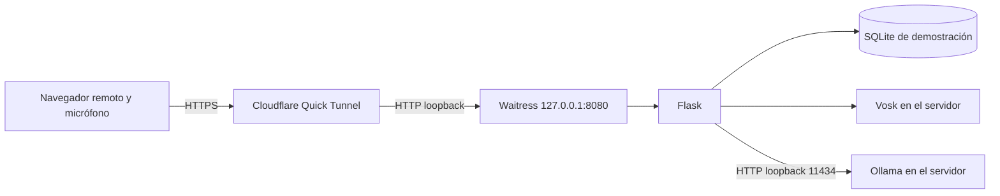

# VOXBOARD — Primera demostración por internet

Revisión: 19 de noviembre de 2026. Esta preparación no inicia un túnel ni publica datos. Es una demostración controlada, no un servicio multiusuario permanente.

## 1. Cambios de despliegue

- `server.py`: Waitress 3.0.2, ocho hilos, sin depuración ni trazas públicas, limitado a `127.0.0.1:8080`.
- `--demo`: base ficticia separada en `instance/demo/voxboard.sqlite3` y clave propia en `instance/demo/.secret_key`. No copia cuentas ni datos habituales. La cuenta se configura privadamente, sin contraseña de ejemplo.
- `--tunnel`: exige cuenta previamente creada, activa cookies Secure y fija el esquema WSGI HTTPS. Waitress limpia cabeceras de proxy no confiables; no hay ProxyFix abierto. Cloudflared debe conservar el Host público: no usar `--http-host-header localhost`.
- Importar `app.py` ya no abre automáticamente la base habitual. `python app.py` sigue disponible para desarrollo local; usar Waitress para el túnel.
- Cabeceras `nosniff`, prohibición de iframe, micrófono del propio origen y caché privada sin almacenamiento. La captura continúa solo por clic, con envío WAV al mismo origen y timeout de transcripción de 120 segundos.
- SQLite: espera de 30 segundos en conexiones de trabajo y herramientas de respaldo/restauración en `manage_data.py`.
- `.gitignore`: excluye `instance/`, bases, respaldos, claves, `.env`, logs, configuración cloudflared, entorno virtual y modelos descargados.

## 2. Arquitectura y alcance



El navegador no llama al localhost del visitante: endpoints y recursos se resuelven contra el origen público de VOXBOARD. Ollama permanece accesible solo desde Flask. No abrir los puertos de Ollama ni SQLite a internet. El dispositivo visitante no instala Vosk ni Ollama.

El audio viaja por HTTPS y Cloudflare hasta el equipo servidor; Vosk lo procesa allí y no lo guarda como archivo. Esta modalidad necesita internet, aunque los modelos se ejecutan localmente. No describir la demostración remota como una conexión completamente sin internet.

Hay **una sola cuenta docente** por base. No hay registro de cuentas adicionales ni separación de datos entre profesores. Quienes utilicen esa cuenta compartirán curso y registros. No presentar esta versión como un servicio multiinstitucional.

Quick Tunnel entrega una URL temporal, cambia al reiniciarse y no tiene garantía de disponibilidad. No necesita dominio ni cuenta Cloudflare; la URL no sustituye el inicio de sesión. VOXBOARD no usa SSE: Ollama responde con `stream:false`.

## 3. Preparación privada

Desde la raíz del proyecto:

```powershell
.\.venv\Scripts\python.exe -m pip install -r requirements.txt
.\.venv\Scripts\python.exe .\server.py --demo
```

1. Abrir en el equipo servidor `http://127.0.0.1:8080`.
2. Crear la cuenta docente con una contraseña propia, distinta de las claves ficticias de pruebas. Si ya existe una cuenta en esta base, iniciar sesión con ella.
3. Comprobar el curso y los cinco estudiantes ficticios. Anotar los ID visibles para los comandos.
4. Cerrar sesión y detener Waitress con `Ctrl+C`.

La demo conserva sus datos entre reinicios y no toca `instance/voxboard.sqlite3`. La carga ficticia es idempotente. No borra registros en cada arranque.

### Vosk y Ollama

Verificar el modelo descomprimido en `models/vosk-model-small-es-0.42/`. La primera transcripción carga el modelo. La comprobación de disponibilidad inicial solo revisa carpeta/paquete; transcribir comprueba la carga real.

En el servidor, abrir Ollama y comprobar:

```powershell
ollama list
Invoke-RestMethod http://127.0.0.1:11434/api/tags
```

Si falta el modelo:

```powershell
ollama pull qwen2.5:3b
```

Si Ollama no está abierto, ejecutar `ollama serve` en otra terminal. No iniciar otra instancia si ya ocupa el puerto. Configuración existente: `OLLAMA_MODEL=qwen2.5:3b`, `OLLAMA_URL=http://127.0.0.1:11434`, `OLLAMA_TIMEOUT=120`. Son variables de entorno o claves de la factoría. No hay carga automática de `.env`.

Precalentar el modelo y ensayar con resúmenes breves. Los tiempos excesivos también pueden superar límites del proxy; el timeout de aplicación no garantiza que el túnel espere indefinidamente.

## 4. Instalar cloudflared

Durante la revisión no se encontró `cloudflared` en PATH. No se instaló ni se abrió el túnel. Obtenerlo desde las descargas oficiales para Windows o instalar con Windows Package Manager:

```powershell
winget install --id Cloudflare.cloudflared --exact
```

Abrir una terminal nueva y comprobar:

```powershell
cloudflared --version
```

La instalación puede pedir permisos de Windows. Si se descarga el ejecutable sin incorporarlo al PATH, usar su ruta en los comandos. Quick Tunnel no necesita instalar un servicio Windows. No guardar tokens, certificados o configuraciones privadas en Git.

## 5. Comandos preparados para el siguiente paso

**El túnel público no se ejecutó en esta revisión.**

Primera terminal, desde el proyecto:

```powershell
.\.venv\Scripts\python.exe .\server.py --demo --tunnel
```

Segunda terminal:

```powershell
cloudflared tunnel --url http://127.0.0.1:8080
```

Abrir y compartir la URL **HTTPS** de `trycloudflare.com` que imprima cloudflared. No inventar un hostname ni abrir `127.0.0.1` desde el otro dispositivo. No habilitar CORS global ni cambiar Waitress a `0.0.0.0`: el túnel conecta al loopback.

En modo `--tunnel`, el acceso previsto es HTTPS externo. Para configurar por HTTP local, arrancar sin `--tunnel`. El origen interno sigue siendo HTTP porque TLS termina en Cloudflare; este modo fija el esquema WSGI y las cookies adecuadas para ese despliegue concreto.

Para cerrar, `Ctrl+C` primero en cloudflared y después en Waitress. Mantener el equipo servidor encendido, conectado y sin suspensión durante la prueba. No omitir `--demo` en esta primera demostración: sin él se seleccionan los datos habituales.

## 6. Pruebas desde otro dispositivo

Usar únicamente datos ficticios y navegador actualizado. Abrir directamente el sitio, sin iframe ni navegador interno de una red social.

1. Abrir la URL HTTPS: debe aparecer Iniciar sesión, no Crear cuenta docente. Probar credenciales incorrectas y luego la cuenta privada.
2. Revisar portada, avatar, Ayuda y menús en ancho amplio y estrecho. Las animaciones no deben solicitar micrófono.
3. Pulsar Hablar con Vox y permitir el micrófono del dispositivo remoto. Decir «mostrar ciclo del agua» y hacer pausa: debe abrir el modal sin Terminar de hablar. Cerrar con X o Escape; en móvil usar X.
4. Probar «mostrar sistema solar», un comando desconocido y Cancelar grabación. Confirmar que se libera el micrófono.
5. Con un ID real del listado ficticio, decir «marcar presente al estudiante uno». Revisar fecha, nombre y estado y confirmar. Registrar otra fecha; corregir la misma y comprobar persistencia sin duplicados.
6. Decir «registrar nota ochenta y cinco al estudiante uno», revisar contexto y cancelar: no debe cambiar la nota. Repetir y confirmar. Recargar formularios.
7. Abrir Pizarra y resumen: probar botones y voz, usando Detener y transcribir en esa pantalla. Dictar, editar, guardar y recuperar el resumen.
8. Abrir Ollama en el servidor: generar trivia, editar una pregunta, guardar y proyectar sin clave. Generar/editar/guardar un comentario y recargar.
9. Revisar indicadores con nota 0, asistencia pendiente y empate; descargar CSV/XLSX y comprobar en Excel tildes, columnas y valores.
10. Cerrar sesión: volver a rutas de trabajo o descargas debe exigir acceso. Esta versión no admite cuentas independientes para otros docentes.

En herramientas de desarrollo, `/api/voz/transcribir` debe usar el mismo hostname HTTPS de VOXBOARD, `Content-Type: audio/wav`, CSRF y devolver JSON con `text`. No debe llamar al localhost del visitante ni a Ollama directamente. No compartir cookies ni capturas de cabeceras privadas.

## 7. Persistencia y recuperación

| Uso | Base | Clave |
| --- | --- | --- |
| Habitual | `instance/voxboard.sqlite3` | `instance/.secret_key` |
| Demo | `instance/demo/voxboard.sqlite3` | `instance/demo/.secret_key` |

Las rutas se resuelven desde la raíz del proyecto. Cloudflare no almacena ni sustituye la base del servidor. Las claves se mantienen al reiniciar y no se imprimen.

Respaldar demo:

```powershell
.\.venv\Scripts\python.exe .\manage_data.py backup --demo
```

Omitir `--demo` para respaldar los datos habituales. Se crea una copia fechada en `backups/` junto a la base mediante la API SQLite; se verifican integridad, relaciones y tablas principales. Conservar la clave por separado de forma privada: el comando no la copia y no programa respaldos automáticos.

Restaurar solo con el túnel y **todas** las instancias de VOXBOARD detenidas. Reemplazar el marcador por un archivo real:

```powershell
.\.venv\Scripts\python.exe .\manage_data.py restore --demo --source '.\instance\demo\backups\NOMBRE_REAL_DEL_RESPALDO.sqlite3' --server-stopped
```

`--server-stopped` es una declaración del operador, no detección automática. Se conserva el destino previo, incluso si está dañado, y se valida una copia temporal antes de reemplazarlo. Una fuente inválida no sustituye el destino. Si hay archivos WAL/journal auxiliares, se detiene la operación para revisión; no borrarlos con la aplicación abierta.

La cuenta y su hash pertenecen a SQLite. Cambiar la clave invalida accesos y confirmaciones, pero no borra datos. Ensayar la restauración sobre una copia aislada antes de usarla con registros reales.

## 8. Git y cuentas

No hay credenciales predeterminadas de ejecución. Las claves ficticias de `tests/` son solo para pruebas. `.gitignore` excluye los datos privados y modelos externos.

No se detectó `.git` en esta carpeta: no fue posible auditar historial ni archivos previamente seguidos. `.gitignore` no elimina secretos publicados ni deja de seguir archivos ya versionados. En el repositorio que se vaya a subir, revisar `git ls-files`, retirar del índice los datos privados y rotar secretos expuestos. No reescribir el historial sin revisar el caso.

## 9. Evidencia y pendientes

| Verificación | Resultado |
| --- | --- |
| Python | 62 pruebas aprobadas: acceso, anualidad, registros, voz, IA simulada, indicadores, exportaciones, Ayuda y despliegue. |
| JavaScript | 19 pruebas aprobadas: WAV, worklet, pausa automática, comandos, recursos y avatar. |
| Waitress real local | Host remoto simulado, esquema HTTPS fijo, cookies Secure, protección, logout y POST de audio. No es prueba de TLS público. |
| Chrome sobre Waitress | Audio sintético, Vosk real y texto sustituido por frases controladas: recurso sin curso, pausa, nota cancelada, dos fechas, corrección y nueva gestión con historial. |
| Ensayo adicional de pizarra | `run_phase5c.py` con `VOXBOARD_FULL_TEST=0`: pizarra, cinco comandos, avatar, dictado persistente, cancelación/confirmación, notas, asistencia y acceso aprobados en Chrome con audio simulado. |
| Respaldos | Recuperación temporal, rechazo de fuente inválida y recuperación sobre destino dañado. |
| Base habitual | Ensayo Chrome comparó SHA-256 antes/después: intacta. |
| Ollama real | No respondió la comprobación local del puerto 11434. Generación/errores cubiertos con simulaciones; verificar servicio y modelo antes del túnel. |
| HTTPS externo y micrófono físico remoto | Pendientes para el siguiente paso, desde otro dispositivo. |
| cloudflared | No encontrado en PATH; instalación y versión pendientes. |

`run_phase5c.py` se adaptó al inicio anual para no buscar el antiguo selector manual. Su modo completo con Ollama real no se ejecutó aquí. No confundirlo con las suites ni con el ensayo del inicio aprobados.

## 10. Referencias

- [Waitress: argumentos y esquema WSGI](https://docs.pylonsproject.org/projects/waitress/en/stable/arguments.html).
- [Cloudflare: Quick Tunnels y límites](https://developers.cloudflare.com/tunnel/get-started/quick-tunnels/).
- [Cloudflare: descargas Windows](https://developers.cloudflare.com/tunnel/downloads/).
- [MDN: getUserMedia y contexto seguro](https://developer.mozilla.org/en-US/docs/Web/API/MediaDevices/getUserMedia).
